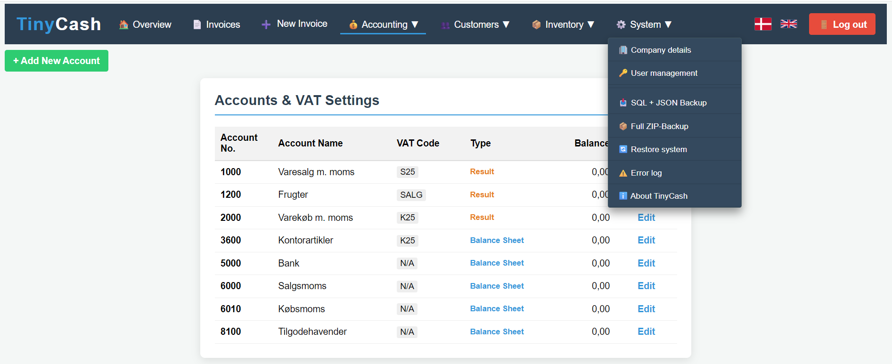

# TinyCash 🛠️

**TinyCash is an open-source, web-based accounting system written in PHP, with support for MySQL and SQLite.**

**The system supports over 180 languages, 13 of which are currently pre-configured with a minimal translation covering the main menu and essential system elements.**

**The system is developed to comply with Danish bookkeeping requirements (bogføringsloven, BEK 97/2023 and 811/2026). It can be hosted on anything from a standard web server to a private NAS.**

**It provides a fast, efficient, and self-reliant solution for invoicing, inventory management, VAT handling, and more.**

Latest release: **[v.1.3](https://github.com/EV-soft/TinyCash/releases/latest)** – see the release notes for what is new.

### Core Features & Strengths

- 🌍 **Smart Language Engine:** TinyCash supports automated translation via OpenAI (or DeepL). The system automatically scans the source code for English strings and provides a central management page for translations – now with 13 languages prepared.

- 📒 **Danish Standard Chart of Accounts:** The official standard chart of accounts 2026 (Erhvervsstyrelsen) is built in – start with it, import it, or switch to it from a date with balances transferred. Every account can be mapped for the SAF-T export.

- 🛒 **Web Shops:** WooCommerce and Shopify send their orders straight to TinyCash; PrestaShop orders are fetched by TinyCash. An invoice per order or the sales of a day booked together – and the payouts from the payment provider are reconciled with the fee.

- 📦 **Automated Inventory Management:** Inventory levels are updated automatically when items are sold and invoices are posted, ensuring full synchronization between sales and stock.

- 💱 **Multi-Currency Support:** Choose your own bookkeeping currency, invoice customers in a different one, and let the system post automatic exchange-rate gains/losses.

- 🔐 **Privacy & Ownership (Self-Hosted):** Your data is 100% yours. No dependency on third-party cloud solutions, no monthly subscriptions. Run everything securely on your own infrastructure – several ledgers in one installation if you like.

- ⚡ **High Performance:** Built with clean PHP/MySQL logic, ensuring fast execution even on simple shared hosting environments.

- 🛠️ **Developer-Centric Architecture:** The system is centralized around a robust library (`php2htm.lib.php`) that handles everything from theme management (Light/Custom/Dark) to reusable UI components, making the code modular and easy to maintain.

- *The current code is written by EV-soft in close collaboration with AI assistants.*

### Key Features

- **Customers & Suppliers:** Customer and supplier registers with contacts, CVR lookup, statements, credit limits and a trash bin.

- **Sales:** Quotes with follow-up, invoices with several layouts and line discounts, recurring invoices, credit notes (also partial), reminders with fees, payment registration and bad-debt write-off. E-invoices (OIOUBL) and a PDF archive.

- **Purchases:** Expenses with voucher requirement, split on several accounts, recurring expenses, duplicate check and supplier payment export.

- **Inventory:** Real-time tracking with automatic stock deduction upon sales, cost price and margin.

- **Document Management:** AI-assisted scanning, interpretation, bookkeeping, and electronic archiving of documents.

- **Bank:** CSV import with saved profiles and rules for reconciliation, plus direct PSD2 bank integration (Enable Banking).

- **Bookkeeping & Reports:** Double-entry ledger with unique voucher numbers and append-only postings, VAT report and reconciliation, income statement with budgets, balance sheet, trial balance, account cards, fixed assets with depreciation, year-end closing and annual report (class B), SAF-T export and import.

- **Control:** Audit log, login history with two-factor login, voucher-sequence and balance checks, sub-ledger reconciliation and segregation-of-duties report.

- **Projects & Time:** Projects with time tracking, invoicing of hours and project statements.

- **Backup:** Centralized control of regular, encrypted backups for data, documents, mail, and other files – including a test restore.

- **Integrated Tools:** A built-in toolkit for code review, backup, database migration, and advanced language management.

- **Theme Selection:** Customizable visual themes (Light, Dark, Custom).

- **User Levels:** The menu allows you to restrict features based on user roles: Simple – Advanced – System Administrator. An administrator can hide menu items and form fields for the lower levels.

### Installation & Configuration

1. **Upload:** Upload all files from the source archive to a PHP-compatible server (Requirement: PHP 8.0+).

2. **Configuration:** Copy `inc/data/template_env.ini` to `inc/data/env.ini` and fill it in – the database, and if you like mail, OpenAI/DeepL and Enable Banking. Settings left empty only switch the matching feature off.

3. **Database Setup**

   - **SQLite (the quickest):** A demo database is included as `inc/data/tinycash.sq-lite` – rename (or copy) it to `inc/data/tinycash.sqlite`, and log in with **admin / eventyr123** (change the password right away). Without it, run the setup scripts in `db-setup/` (see `db-setup/README.md`) for an empty system.

   - **MySQL:** Create a MySQL database via your control panel and a database user with full privileges, put them into `inc/data/env.ini` (`ACTIVE_DB="mysql_config"`), then run the setup scripts in `db-setup/` (see `db-setup/README.md`) to build the schema.

4. **Chart of Accounts:** Choose a chart of accounts under *System → Maintenance → Chart of Accounts Proposal* – the Danish standard chart, or one of the three templates (all selections of the standard chart).

5. **Language:** The system currently includes 13 pre-defined languages. You can add or edit texts on the management page located under *System/Control Panel/Language Editing*, or directly in `/json-data/languages.json`.

### Updating an Existing Installation

1. Take a backup (*System → Maintenance → Backup Management*).
2. Upload the new files – but keep your own `inc/data/` (`env.ini` and the database).
3. Open *System → Maintenance → Database migration* (`run_migrate.php`) and run every migration marked **Pending**.

 
 
 

# **TinyCash 🛠️**

**TinyCash er et open source webbaseret regnskabssystem, skrevet i PHP, og understøttet af MySQL og SQLite.**

Systemet understøtter over 180 sprog, hvoraf 13 sprog i øjeblikket er forberedt med en minimal oversættelse, der dækker hovedmenuen og systemets vigtigste elementer.

Systemet er udviklet med henblik på at opfylde de danske lovkrav der stilles til bogføringsprogrammer (bogføringsloven, BEK 97/2023 og 811/2026). Programmet kan afvikles på alt fra standard webhotel, til egen NAS-server.

Det løser dine behov for hurtig, effektiv og selvhjulpen håndtering af fakturering, lagerstyring, momshåndtering m.v.

Seneste udgivelse: **[v.1.3](https://github.com/EV-soft/TinyCash/releases/latest)** – se udgivelsesnoterne for nyhederne.

### **Kerneegenskaber & Styrker**

- 🌍 **Smart Sprog-motor:** TinyCash understøtter automatiseret oversættelse via OpenAI (eller DeepL). Systemet scanner automatisk kildekoden for sætninger (på engelsk) og giver dig en central redigeringsside til at administrere oversættelser – nu med 13 forberedte sprog.

- 📒 **Standardkontoplanen:** Erhvervsstyrelsens standardkontoplan 2026 er bygget ind – start med den, importér den, eller skift til den fra en dato med overførsel af saldi. Alle konti kan knyttes til standarden til SAF-T-eksporten.

- 🛒 **Webbutikker:** WooCommerce og Shopify sender deres ordrer direkte til TinyCash; PrestaShops ordrer henter TinyCash selv. En faktura pr. ordre eller dagens salg bogført samlet – og udbetalingerne fra betalingsudbyderen afstemmes med gebyret.

- 📦 **Automatiseret Lagerstyring:** Lagerbeholdningen opdateres automatisk, når varer sælges og fakturaer bogføres, hvilket sikrer fuld synkronisering mellem salg og beholdning.

- 💱 **Understøttelse af Flere Valutaer:** Vælg din egen bogføringsvaluta, fakturér kunder i en anden, og lad systemet bogføre automatiske kursgevinster/-tab.

- 🔐 **Privatliv & Ejerskab (Self-Hosted):** Dine data er 100% dine. Ingen afhængighed af tredjeparts sky-løsninger, ingen månedlige abonnementer. Kør alt sikkert på din egen infrastruktur – gerne flere regnskaber i én installation.

- ⚡ **Høj Ydeevne:** Bygget med ren PHP/MySQL-logik, hvilket sikrer hurtig eksekvering, selv på simple delte hosting-miljøer.

- 🛠️ **Udvikler-centreret Arkitektur:** Systemet er centraliseret omkring et robust bibliotek (`php2htm.lib.php`), der håndterer alt fra tema-styring (Light/Custom/Dark) til genanvendelige UI-komponenter, hvilket gør koden modulær og let at vedligeholde.

- *Den nuværende kode er skrevet af EV-soft i tæt samarbejde med AI-assistenter.*

### **Vigtigste Funktioner**

- **Kunder & Leverandører:** Kunde- og leverandørregister med kontaktpersoner, CVR-opslag, kontoudtog, kreditgrænser og papirkurv.

- **Salg:** Tilbud med opfølgning, fakturaer med flere layouts og linjerabat, faste fakturaer, kreditnotaer (også delvise), rykkere med gebyr, registrering af betaling og afskrivning af tab. E-fakturaer (OIOUBL) og PDF-arkiv.

- **Køb:** Udgifter med bilagskrav, fordeling på flere konti, faste udgifter, dubletkontrol og eksport af leverandørbetalinger.

- **Lagerstyring:** Realtidssporing med automatisk nedskrivning af beholdning ved salg, kostpris og avance.

- **Bilagsstyring:** AI-skanning og tolkning af bilag, samt journalisering og elektronisk arkivering af disse.

- **Bank:** CSV-import med gemte profiler og regler til afstemning, samt direkte PSD2-bankintegration (Enable Banking).

- **Bogføring & Rapporter:** Dobbelt bogholderi med hulfri bilagsnumre og uforanderlige posteringer, momsangivelse og momsafstemning, resultatopgørelse med budget, balance, saldobalance, kontokort, anlægsaktiver med afskrivninger, årsafslutning og årsrapport (klasse B), SAF-T-eksport og -import.

- **Kontrol:** Revisionsspor, login-historik med tofaktor-login, kontrol af bilagsrække og balance, afstemning af debitorer/kreditorer og rapport over adskillelse af funktioner.

- **Projekter & Tid:** Projekter med tidsregistrering, fakturering af timer og projektkontokort.

- **Backup:** Kontrol af regelmæssig, krypteret backup af data, bilag, mail og andre dokumenter – inklusive prøvegendannelse.

- **Integrerede Værktøjer:** Et indbygget værktøjssæt til kodegennemgang, backup, migrering af databaser og avanceret sprogstyring.

- **Tema-valg:** Programmets farvevalg, d.v.s. visuelle temaer (Light, Dark, Custom).

- **Brugerniveau:** I programmets menu kan der ”slukkes” for forskellige punkter svarende til brugerfunktion: Simpel – Avanceret – System ansvarlig. En administrator kan skjule menupunkter og felter for de lavere niveauer.

### **Installation & Konfiguration**

1. **Upload:** Upload al programkode fra kilde-arkivet til en PHP-kompatibel server. (Krav: PHP 8.0+)

2. **Konfiguration:** Kopiér `inc/data/template_env.ini` til `inc/data/env.ini` og udfyld den – databasen, og hvis du vil, mail, OpenAI/DeepL og Enable Banking. Tomme indstillinger slår blot den tilhørende funktion fra.

3. **Database Opsætning**

   - **SQLite (det hurtigste):** En demo-database følger med som `inc/data/tinycash.sq-lite` – omdøb (eller kopiér) den til `inc/data/tinycash.sqlite`, og log ind med **admin / eventyr123** (skift kodeordet med det samme). Uden den køres opsætningsscripterne i `db-setup/` (se `db-setup/README.md`) til et tomt system.

   - **MySQL:** Opret en MySQL-database via dit kontrolpanel og en database-bruger med fulde rettigheder, skriv dem i `inc/data/env.ini` (`ACTIVE_DB="mysql_config"`), og kør derefter opsætningsscripterne i `db-setup/` (se `db-setup/README.md`) for at oprette skemaet.

4. **Kontoplan:** Vælg kontoplan under *System → Vedligeholdelse → Kontoplanforslag* – Erhvervsstyrelsens standardkontoplan eller en af de tre skabeloner (alle udsnit af standardkontoplanen).

5. **Sprog:** Systemet indeholder nu 13 prædefinerede sprog. Du kan tilføje eller rette tekster på redigeringssiden, som du finder under System/Kontrolpanel/Sprog redigering, eller direkte i `/json-data/languages.json`.

### **Opdatering af en eksisterende installation**

1. Tag en backup (*System → Vedligeholdelse → Backup-administration*).
2. Upload de nye filer – men behold din egen `inc/data/` (`env.ini` og databasen).
3. Åbn *System → Vedligeholdelse → Database vedligeholdelse* (`run_migrate.php`), og kør alle opdateringer markeret **Mangler**.

 
 

---

## 🚀 Quick Demo Installation

Want to try TinyCash without setting up a database by hand? Three files are hosted at **[ev-soft.dk/tc-demo-boot](https://ev-soft.dk/tc-demo-boot/)**:

- **[tinycash.boot.zip](https://ev-soft.dk/tc-demo-boot/tinycash.boot.zip)** – the full application with a working demo database already built in (theme: H.C. Andersen's fairy tales) – no setup wizard needed.
- **[tinycash.boot.php](https://ev-soft.dk/tc-demo-boot/tinycash.boot.php)** – a small installer script that unpacks the zip file for you.
- **[tinycash.boot.txt](https://ev-soft.dk/tc-demo-boot/tinycash.boot.txt)** – the full bilingual (EN/DA) instructions, including how to later switch to MySQL, enable mail/AI features, and more.

**How to use it:**

1. Download both `tinycash.boot.zip` and `tinycash.boot.php` from the links above.
2. Create a **new, empty** folder on your own PHP web server (PHP 8.1+ recommended, with the `zip` extension enabled) – never an existing TinyCash installation.
3. Upload both files into that folder (binary/FTP mode for the `.zip`).
4. Open `tinycash.boot.php` in your browser, e.g. `https://your-domain.example/tinycash.boot.php`.
5. The script unpacks everything automatically and shows a confirmation page.
6. Log in with **admin / eventyr123**, then change the password right away.

⚠️ Once you're done exploring, delete `tinycash.boot.php` and `tinycash.boot.zip` from the server – they should never be left reachable on a live site. See `tinycash.boot.txt` for the full guide, including how to register additional ledgers or convert this demo into a real, production-ready installation.

---

## 🚀 Hurtig Demo-installation

Vil du prøve TinyCash uden selv at skulle sætte en database op? Tre filer ligger på **[ev-soft.dk/tc-demo-boot](https://ev-soft.dk/tc-demo-boot/)**:

- **[tinycash.boot.zip](https://ev-soft.dk/tc-demo-boot/tinycash.boot.zip)** – hele programmet med en færdig demo-database allerede bygget ind (tema: H.C. Andersens eventyr) – ingen opsætningsguide nødvendig.
- **[tinycash.boot.php](https://ev-soft.dk/tc-demo-boot/tinycash.boot.php)** – et lille installations-script, der udpakker zip-filen for dig.
- **[tinycash.boot.txt](https://ev-soft.dk/tc-demo-boot/tinycash.boot.txt)** – den fulde tosprogede (EN/DA) vejledning, inkl. hvordan du senere skifter til MySQL, aktiverer mail-/AI-funktioner m.m.

**Sådan bruger du det:**

1. Download både `tinycash.boot.zip` og `tinycash.boot.php` fra linkene ovenfor.
2. Opret en **ny, tom** mappe på dit eget PHP-webhotel (PHP 8.1+ anbefales, med "zip"-udvidelsen aktiveret) – aldrig en eksisterende TinyCash-installation.
3. Upload begge filer til den mappe (binær/FTP-tilstand til `.zip`-filen).
4. Åbn `tinycash.boot.php` i din browser, fx `https://dit-domæne.eksempel/tinycash.boot.php`.
5. Scriptet udpakker automatisk alt og viser en bekræftelsesside.
6. Log ind med **admin / eventyr123**, og skift kodeordet med det samme.

⚠️ Når du er færdig med at udforske, så slet `tinycash.boot.php` og `tinycash.boot.zip` fra serveren – de må aldrig ligge tilgængelige på en rigtig, kørende installation. Se `tinycash.boot.txt` for den fulde vejledning, inkl. hvordan du registrerer flere regnskaber eller konverterer denne demo til en rigtig, produktionsklar installation.
